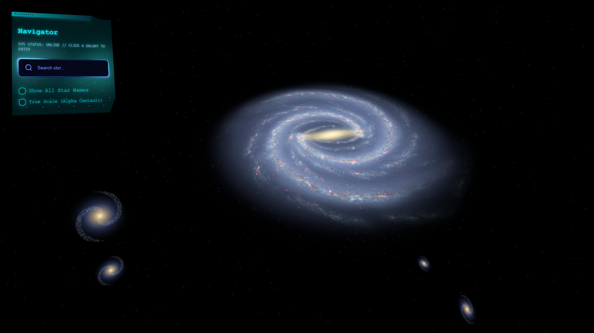

<div align="center">

# Cosmoscape

**Fly from the Milky Way down to a single star system, right in your browser or as a desktop app.**


<p style="margin-bottom: 30px;">Main Startup Screen</p>

[](LICENSE)
[](https://www.python.org/)
[](https://threejs.org/)
[](https://www.electronjs.org/)
[](https://github.com/robolivice/cosmoscape/stargazers)

[Quick start](#quick-start-web-version) · [Desktop app](#desktop-app-electron) · [Importing data](#importing-data) · [Controls](#controls) · [Credits](CREDITS.md)

</div>

A 3D star map built with FastAPI, SQLite and three.js. Search for stars, enter their
systems, and read or edit notes on any object. It runs in a browser or as an Electron
desktop app. Both versions share the same features.

> **This repository ships no star data.** You build your own local database with
> `ingest.py`, so every catalog stays with its original source and license.
> The premade Windows installer on the Releases page includes a ready-made database.
> See [CREDITS.md](CREDITS.md) for its licensing.

## Quick start (web version)

```bash
git clone https://github.com/robolivice/cosmoscape.git
cd cosmoscape/Cosmoscape-web
python -m venv .venv
# Windows: .venv\Scripts\activate    macOS/Linux: source .venv/bin/activate

pip install -r requirements-ingest.txt
python ingest.py --all
python main.py
```

Open http://127.0.0.1:8000

three.js, marked and the Space Mono font are bundled in `Cosmoscape-FS/frontend/vendor` and
`Cosmoscape-FS/frontend/fonts`, so no internet connection is needed to run the viewer.

Run `python ingest.py --all` **before the first launch**. Without it you only get about
35 hand-picked stars and landmarks, and the other galaxies have no stars at all.

Need only the viewer with minimal data? You can skip `--all` and run
`python ingest.py --curated --galaxies` instead (still install
`requirements-ingest.txt`, because `ingest.py` imports numpy).

Both builds (web and desktop) use the same backend, the same frontend and the same
database, so a catalogue you build once is used by both. The catalog loader can be
started from anywhere:

```bash
python ingest.py --all                              # from Cosmoscape-web/ or Cosmoscape-win/
python -m cosmoscape_fs.ingest --all                # from the repository root
cd Cosmoscape-FS && python -m cosmoscape_fs.ingest --all
```

### Where your data is stored

The database (`universe.db`), your notes (`database/*.md`) and the download caches
(`data/`) are stored in your user data folder, not in the repository:

| OS | Location |
|---|---|
| Windows | `C:\Users\<you>\AppData\Local\Cosmoscape` |
| macOS | `~/Library/Application Support/Cosmoscape` |
| Linux | `~/.local/share/Cosmoscape` |

The server prints the paths it uses on startup:

```
data    : C:\Users\<you>\AppData\Local\Cosmoscape
db      : C:\Users\<you>\AppData\Local\Cosmoscape\universe.db
notes   : C:\Users\<you>\AppData\Local\Cosmoscape\database
frontend: ...\Cosmoscape-FS\frontend
```

The location can be changed with environment variables (the first one that is set
wins):

| Variable | Overrides |
|---|---|
| `COSMOSCAPE_DB` | the database file |
| `COSMOSCAPE_DATA` | the whole data folder (database, notes, caches) |
| `COSMOSCAPE_MARKDOWN` | the notes folder |
| `COSMOSCAPE_CACHE` | the download cache folder |

If the server starts with a `db: WARNING - a new, nearly empty database was
created`, it did not find your catalogue (usually a leftover `COSMOSCAPE_DB`
variable). Unset it (`Remove-Item Env:COSMOSCAPE_DB`) and check the printed path.

## Desktop app (Electron)

The desktop app wraps the same FastAPI backend and frontend in an Electron window. The
backend starts on a free local port and is stopped when you close the app.

**Requirements:** Node.js 18+, Python 3.10+, and PyInstaller for building.

The desktop app lives in the `Cosmoscape-win/` folder. Run every command in this
section from there, because the build script uses relative paths.

### Run in development

```bash
cd cosmoscape/Cosmoscape-win
npm install
pip install -r requirements.txt
npm start
```

`npm start` launches Electron, which starts `python main.py` in the background.

### Build an installer

1. Build your database once with `python ingest.py --all`.
2. Copy the finished `universe.db` into the existing `seed/` folder in `Cosmoscape-win/`
   as `seed/universe.db`. The folder is kept in the repository by a `.gitkeep` file. The
   build fails if `seed/universe.db` is missing. The installed app copies the database
   into the user data folder on first launch.
3. Optionally, put your notes in `seed/database/` to ship them as well.
4. Build:

```bash
pip install pyinstaller
npm run build:backend
npm run dist
```

The installer ends up in `release/` (NSIS on Windows, DMG on macOS, AppImage on Linux).
Icons are read from `build/`.

`package_db.py` compresses a database into `universe.db.gz` and prints its SHA256, for
hosting a downloadable copy. Set `DB_URL` and `DB_SHA256` in
`Cosmoscape-FS/cosmoscape_fs/desktop.py` (or the `COSMOSCAPE_DB_URL` and
`COSMOSCAPE_DB_SHA256` environment variables) to use it.

## Premade installer

If you don't want to build anything yourself, download the latest installer from the
[Releases](https://github.com/robolivice/cosmoscape/releases) page. It is currently
available for Windows only, with other platforms planned. It includes the full star
database, so you don't need to run `ingest.py`. The bundled database is fixed. For a
custom database or installer, follow the **Desktop app** section above.

## Importing data

| Flag | Source | Notes |
|---|---|---|
| `--curated` | built in | Hand-picked stars and landmarks. Offline, instant. |
| `--hyg [path]` | HYG database | About 120k stars. Auto-download may fail; if so, put the CSV in `data/` yourself. |
| `--exo` | NASA Exoplanet Archive | Real planets and host stars. |
| `--simbad` | SIMBAD | Nearby stars and catalog IDs for landmarks. |
| `--vizier` | VizieR | Open clusters (Cantat-Gaudin et al. 2020). |
| `--gaia [N]` | Gaia DR3 | N brightest stars within about 3 kpc (default 300000). Slowest; the download is cached in `data/`. |
| `--galaxies [N]` | generated | Placeholder stars for the other galaxies. Needs `--curated` (or `--all`) on a fresh database. |
| `--wiki [N]` | Wikipedia | Writes summaries into the `database/` notes folder. |
| `--all` | everything | Runs all of the above in the right order. |

Flags can be combined, e.g. `python ingest.py --curated --exo --gaia 100000`.
Re-running is safe; duplicates between catalogs are detected by sky position.

## Controls

- The map opens on a wide view of the galaxies.
- Click a galaxy to fly into it. The camera flies in along your current view, then
  settles close enough for the star markers to appear. Click a star to enter its system.
- Search box: find a star by name or alias (Milky Way only).
- Left-drag orbits, right-drag pans, scroll zooms, arrow keys pan.
- "Show All Star Names" and "True Scale (Alpha Centauri)" toggles in the panel.
- Click an empty part of the Navigator panel to collapse it. Click the "Navigator" button
  at the top left to bring it back.
- Time slider and pause appear inside a star system.
- Texture alignment keys (Milky Way): `[` `]` rotate, `,` `.` scale, `m` mirror.
- Click a star or planet name to open its notes; use Edit Records to change them.

## Textures

The repository needs the images listed in `Cosmoscape-FS/frontend/textures/README.md`. The planet,
Sun and ring textures are loaded as compressed KTX2 files. They are not covered by this
project's license; see `CREDITS.md`.

## Project layout

The repository has one shared `Cosmoscape-FS/` folder and two thin app folders:

- `Cosmoscape-FS/`: everything both builds run
  - `Cosmoscape-FS/cosmoscape_fs/ingest.py`: catalog loader, database schema and helpers
  - `Cosmoscape-FS/cosmoscape_fs/app.py`: the FastAPI application (`create_app()`)
  - `Cosmoscape-FS/cosmoscape_fs/desktop.py`: seed install and database import
    (desktop build only)
  - `Cosmoscape-FS/frontend/`: the shared page, styles, scripts, textures, fonts and
    bundled libraries
- `cosmoscape_fs/`: a one file import shim, so `import cosmoscape_fs` also works
  from the repository root
- `Cosmoscape-web/`: the browser version (run with `python main.py`)
- `Cosmoscape-win/`: the Electron desktop version and installer build

`cosmoscape_fs` is the Python package inside `Cosmoscape-FS` (a folder name with a
dash cannot be imported directly, so the package carries a valid name).

Inside each app folder:

- `main.py`: entry point, it only starts the shared application
- `ingest.py`: entry point for the catalog loader (`python ingest.py --all`)
- `electron/`: desktop shell (`main.js`, `loading.html`), `Cosmoscape-win/` only
- `build_backend.py`: bundles the backend with PyInstaller, `Cosmoscape-win/` only
- `package_db.py`: compresses a database for hosting
- `build/`: app icons for the installers
- `tools/`: helper scripts

The database, the notes and the download caches live in the user data folder, so both
builds always show the same catalogue.

## License

Code: MIT, see `LICENSE`. Textures and star data (including the database in the
premade installer) keep their original licenses, see `CREDITS.md`.

## Credits

Full acknowledgements are in [CREDITS.md](CREDITS.md).